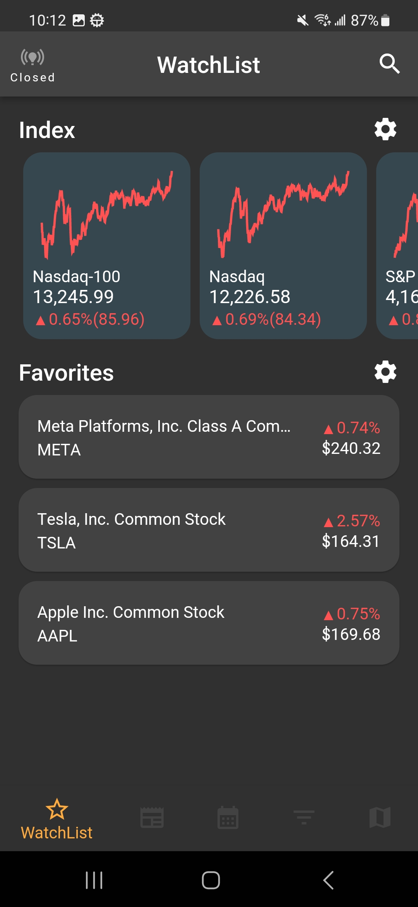
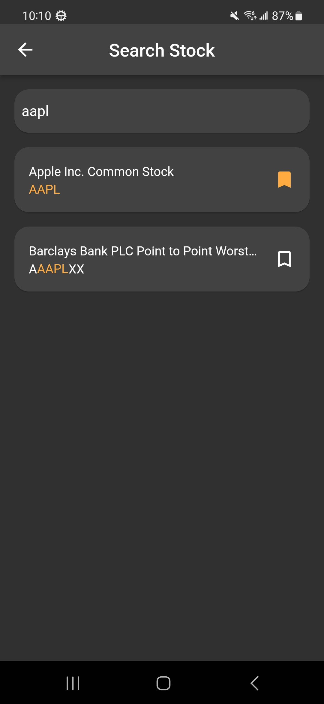
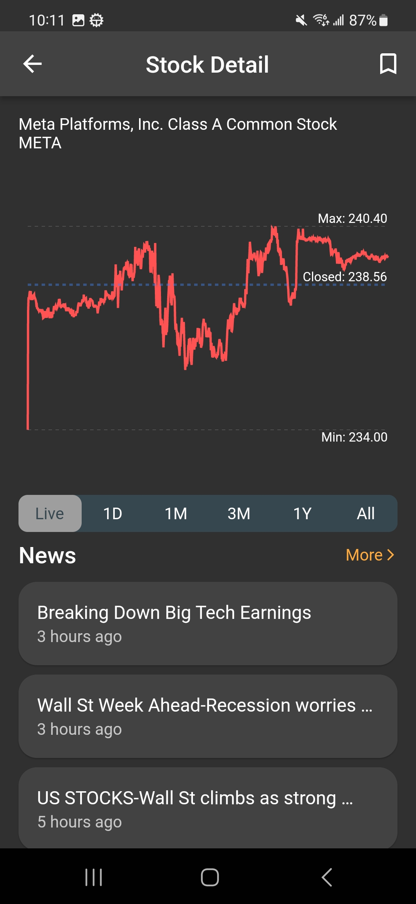
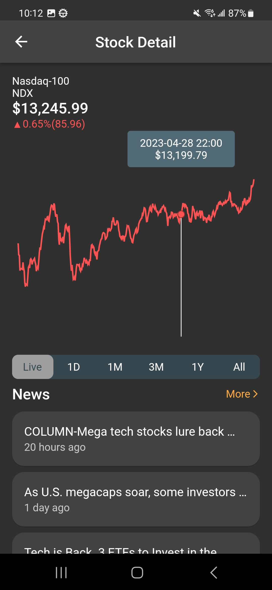
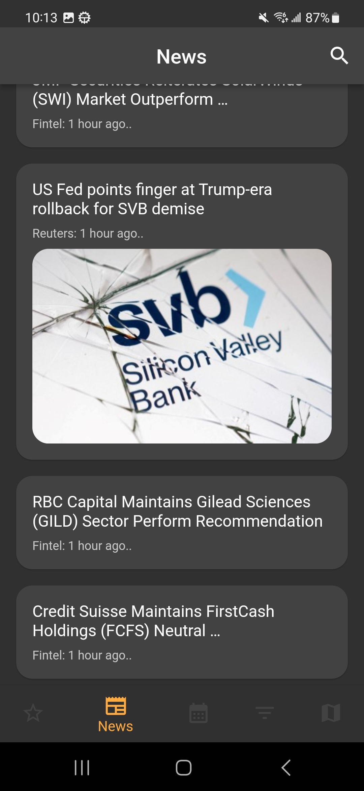
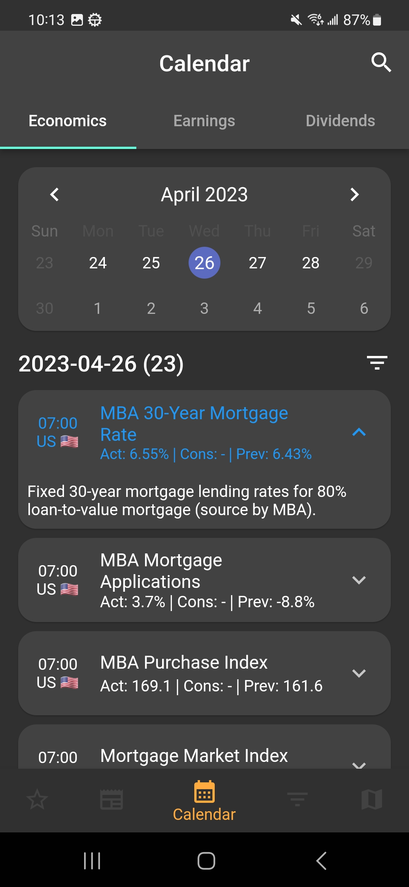
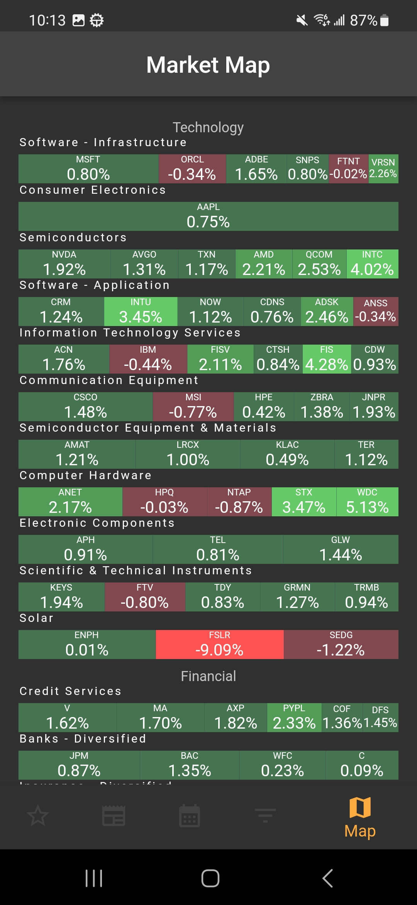

# Investing

Let's make Money with `Investing` APP — a Flutter stock market information app powered by the Nasdaq public API.

[](https://github.com/dev-hann/investing/actions/workflows/ci.yml)
[](https://github.com/dev-hann/investing/actions/workflows/release.yml)

      

## Features

### Stock WatchList

* Search Stock
* Favorite Stock List
* Index List
* Stock Detail
  * Chart
  * Dividend
  * Company News
  * Financial Data
  * Company Profile

### Market News

* Latest News List
* Search News

### Event Calendar

* Economics
* Earnings
* Dividends

### Market Map

* HeatMap S&P500 View

### Setting

* Screener (Work In Progress)

## Getting Started

### Prerequisites

* Flutter `3.47.x` (stable) — includes Dart `3.13`
* JDK 17 (Android builds use AGP 8.13 / Gradle 8.14.3)
* Android SDK (for Android targets)

### Run

```bash
git clone https://github.com/dev-hann/investing.git
cd investing
flutter pub get
flutter run
```

Live heatmap quotes need Alpaca credentials. Create the gitignored config
file once (see `assets/config/README.md`) — the app works without it using
a non-live fallback:

```sh
cp assets/config/alpaca.example.json assets/config/alpaca.json
# edit alpaca.json with your key id + secret (https://alpaca.markets)
flutter run
```

### Verify

```bash
flutter analyze   # must report 0 errors
flutter test
flutter build apk --debug
```

## Project Structure

```
lib/
├── main.dart            # MaterialApp + ProviderScope entry
├── const/               # App constants (colors)
├── controller/          # Riverpod Notifiers (one per feature screen)
├── use_case/            # Use cases bridging controllers and repos
├── repo/                # Repository interfaces + implementations (part-of)
├── data/
│   ├── service/         # HTTP services (dio) + Alpaca IEX websocket
│   └── db/              # Local storage (Hive CE)
├── model/               # Domain models (Equatable, fromMap factories)
├── view/                # Feature screens
├── widget/              # Shared widgets
└── util/                # Formatting helpers
```

Layering and data flow are documented in [docs/ARCHITECTURE.md](docs/ARCHITECTURE.md),
testing conventions in [docs/TESTING.md](docs/TESTING.md).
Architectural decisions are recorded as ADRs in [docs/adr/](docs/adr/).

## Release & Deployment

Releases are fully automated via GitHub Actions:

1. Every push to `main` / PR runs **CI** (analyze + test + debug build).
2. Pushing a version tag builds a signed release APK and publishes it to GitHub Releases:

```bash
git tag v1.0.1
git push origin v1.0.1
```

Release signing uses a dedicated keystore stored in GitHub Secrets (`KEYSTORE_BASE64`, `KEYSTORE_PASSWORD`, `KEY_ALIAS`, `KEY_PASSWORD`). Local builds fall back to debug signing when `android/key.properties` is absent.

## Future Work

* RealTime Update
* Improve Chart View
* Screener

## License

[MIT](License) — Copyright (c) 2023 Han (한)
